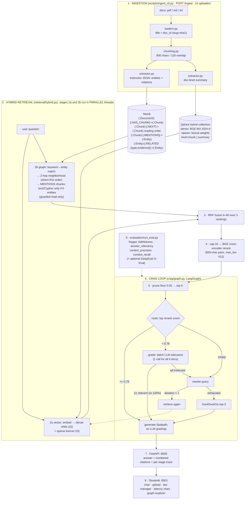

# GraphRAG & Self-Corrective Hybrid Retrieval Engine: Complete Project Guide

> The single document that explains everything: what this project is, why every technology was
> chosen, how data flows through the system, what every file does, how to run and operate it,
> measured performance, real use cases, honest limitations, and the roadmap ahead.

---

## 1. WHAT: the one-paragraph summary

A production-style **Graph-Enhanced Hybrid RAG platform** that answers questions over a document
collection by combining four retrieval signals: dense vector search, sparse lexical search,
knowledge-graph traversal, and cross-encoder reranking, fused with Reciprocal Rank Fusion, and
wrapped in a **self-corrective CRAG loop** (grade → rewrite → web fallback) orchestrated by a
**LangGraph state machine**. It ships with an automated **Ragas/DeepEval evaluation harness**,
a FastAPI service, a Streamlit console, Celery-based async ingestion, and a curated multi-hop
benchmark dataset. Everything runs on **free, self-hostable resources**.

## 2. WHY: the problem it solves

Standard vector-only RAG fails on enterprise knowledge bases in three ways:

| Failure mode | Example | How this project fixes it |
|---|---|---|
| No global entity awareness | "Which supplier's part caused incident X?": the answer spans 3 documents | Neo4j graph connects Product → Component → Supplier → Incident via extracted relations |
| Keyword-blind semantic search | SKU / incident-ID / policy-code lookups ("INC-1042", "SEC-14") | Sparse lexical vectors (BGE-M3) match exact identifiers dense models miss |
| Blind faith in retrieval | Irrelevant chunks silently poison the answer | CRAG loop grades every retrieval; weak evidence triggers query rewriting or a web fallback |
| No quality measurement | "Is my RAG good?" answered by vibes | Ragas + DeepEval harness over a golden multi-hop dataset, runnable in CI |

## 3. WHEN & WHERE: provenance

- **Built:** August 2026 (designed, implemented, tuned, and validated end-to-end on a Mac with
  Docker Desktop, using only free tiers and open-source models).
- **Location:** `~/Downloads/graphrag-hybrid-engine` (single self-contained repo).
- **Live validation:** 17 documents indexed (16 curated Nimbus Robotics corpus + a real resume
  PDF), 143 entities / 128 relations in Neo4j, 32+ vectors in Qdrant, warm query latency
  ~2.1–2.5 s end-to-end with Groq, Ragas faithfulness/precision/recall = 1.0 on golden cases.

## 4. TECH STACK: every choice and why

| Layer | Technology | Why this and not the obvious alternative |
|---|---|---|
| Knowledge graph | **Neo4j 5 Community** (Docker / AuraDB Free) | Native Cypher for multi-hop pattern queries; community edition is free; no APOC dependency used, so it runs anywhere |
| Vector store | **Qdrant OSS** (Docker / Cloud free tier) | One collection holds **named dense + sparse vectors**, true hybrid search in a single index; Rust, fast, simple HTTP API |
| Dense embeddings | **BAAI/bge-m3** (local, 1024-d) | One model yields dense **and** lexical sparse weights, exactly the hybrid pair Qdrant wants; 8k context; free, runs on CPU |
| Sparse vectors | BGE-M3 lexical weights in Qdrant's native sparse index | Learned BM25-style matching for SKUs/IDs without running a separate BM25 pipeline |
| Reranker | **BAAI/bge-reranker-v2-m3** (local cross-encoder) | Cross-encoders see query+document jointly, far more precise than bi-encoders; free, local |
| LLM (default) | **Groq `openai/gpt-oss-20b`** (free tier) | ~10x faster than CPU Ollama; JSON-mode reliable; `reasoning_effort=low` for latency |
| LLM (offline) | **Ollama `llama3.2:3b`** (Docker) | Fully local fallback; auto-selected if no Groq key |
| Structured output | **Instructor** (JSON mode over OpenAI-compatible API) | Pydantic-validated LLM outputs with retries, entities/relations/grades are typed, not string-parsed |
| Orchestration | **LangGraph** | Explicit state machine for the CRAG loop (nodes, conditional edges, iteration caps), inspectable, testable |
| Web fallback | **DuckDuckGo (`ddgs`)** | Keyless, free, no Tavily/Serper key needed |
| Async jobs | **Celery + Redis** | Production-pattern queued ingestion; degrades gracefully to sync mode |
| API | **FastAPI + Uvicorn** | Typed endpoints, auto OpenAPI docs at `/docs` |
| UI | **Streamlit + pyvis + Altair** | Fastest path to an operator console with graph visualization and latency charts |
| Evaluation | **Ragas** (faithfulness, answer relevancy, context precision/recall) + **DeepEval** G-Eval | Open-source RAG metrics; LLM-judge pointed at the same free Groq endpoint |
| Testing/CI | pytest + ruff + GitHub Actions | 49 unit tests; heavy ML tests marked and skipped in CI |
| Chunking | Custom paragraph-greedy splitter (800 chars / 120 overlap) | Deterministic, dependency-free, ~200-token chunks suit entity-dense text |

### The free-resource principle

No paid API is required anywhere. Swap `LLM_PROVIDER` between `groq` (free key), `ollama`
(local), or `openai` (if you insist) with one `.env` line. Embeddings and reranking always run
locally via HuggingFace models.

---

## 5. SYSTEM ARCHITECTURE



## 6. WORKFLOW: what happens on every question, millisecond by millisecond

Measured warm trace (Groq + CPU reranker, sample corpus):

| # | Stage | Typical ms | What actually runs |
|---|---|---|---|
| 1 | vector_search | 100–500 | BGE-M3 encodes the question once → two Qdrant queries (dense ANN top-10, sparse top-10). Runs **in a parallel thread** with stage 2 |
| 2 | graph_search | 26–190 | Regex keywords → `Entity` CONTAINS match → 2-hop `RELATED` expansion → chunks via `MENTIONS` (direct-entity chunks ranked first = hop decay). If **zero** entities matched, one guarded text2Cypher LLM call attempts a traversal (adds ~1.5 s, this is why it is skipped whenever keyword matching succeeds) |
| 3 | rrf_fusion | ~0 | Reciprocal Rank Fusion (k=40) over the 3 rankings; dedupe by chunk id |
| 4 | rerank | ~1500 | Top **16** fused candidates scored by the cross-encoder (600-char pairs, max_length 512) → sorted, floor-pruned, top 6 kept |
| 5a | grade_documents | 0 **or** ~1100 | **Fastpath:** if the best rerank score ≥ 0.78, grading is skipped entirely. Otherwise one batched LLM call grades all 6 docs (relevant/irrelevant + reason) |
| 5b | rewrite_query | 0 **or** ~1000 | Only when grading finds nothing relevant: LLM rewrites the query using grader feedback; loop retrieves once more (hard cap 1 iteration) |
| 5c | web_fallback | ~1–2 s | Only when rewriting still fails: DuckDuckGo top-3 snippets enter the context, clearly labeled |
| 6 | generate | 500–800 | Numbered context blocks + question → Groq (`reasoning_effort=low`) → concise cited answer |
| - | **end-to-end** | **2100–2500** | `stop_reason` tells you which path ran: `generated_fastpath` / `generated` / `generated_with_web` |

### The latency-engineering story (why it is fast)

| Milestone | End-to-end | What changed |
|---|---|---|
| v0 Ollama CPU | 30–60 s+ | everything local, 3B model |
| v1 Groq | ~7.7 s | LLM calls now ~2 s total, but rerank 3.6 s + graph 1.7 s + grade 1.2 s remained |
| v2 tuned | **~2.2 s** | rerank input 30→16 & 1500→600-char pairs (−53%), text2Cypher conditional (−95% graph), grader fastpath ≥0.78 (−100% grade on confident hits), CRAG iterations 2→1, min-relevant 2→1 (kills rewrite loops on answerable questions), `reasoning_effort=low`, vector∥graph threads, models preloaded at startup |

Quality was re-verified after every tuning round: Ragas faithfulness 1.0, context precision 1.0,
context recall 1.0 on golden cases; 49 unit tests green.

## 7. INGESTION WORKFLOW: how documents become a knowledge graph

1. **Load** (`loaders.py`): PDF via pypdf, md/txt direct. Title = first markdown heading, else
   filename. `doc_id = slug(filename) + sha1(absolute_path)[:8]` → re-uploading the same file
   **updates** it (MERGE semantics), never duplicates.
2. **Chunk** (`chunking.py`): paragraphs merged greedily to ~800 chars; oversized paragraphs are
   hard-sliced with overlap; noise (<60 chars) dropped. Adjacent chunks linked `[:NEXT]` to
   preserve reading order.
3. **Extract** (`extractor.py` → `schema.py`): one Instructor JSON-mode call per chunk returns
   `ChunkExtraction`: up to 12 entities (name, type from a fixed allow-list, description) and 8
   relations (source, target, UPPER_SNAKE relation_type, evidence). Failed chunks are skipped
   gracefully, indexing never aborts.
4. **Summarize**: one call per document → stored on the `:Document` node **and** embedded as a
   `kind="summary"` vector, so document-level questions retrieve the summary itself.
5. **Graph write** (`neo4j_store.py`): single write transaction per document, MERGE document,
   chunks, `NEXT` chain, entities (keyed by slugified name → cross-document dedup), `MENTIONS`,
   `RELATED {type, evidence}` edges.
6. **Vector write** (`qdrant_store.py`): chunk texts + the summary embedded with BGE-M3 →
   upserted with payload `{key, doc_id, title, kind}`. Point IDs are uuid5 of the chunk key →
   idempotent re-ingest.

With Groq: ~1–3 s per chunk; the 16-doc corpus indexes in ~7 minutes; a 20-page PDF ≈ 1–2 min.

---

## 8. FILE-BY-FILE MAP: what every file does

### Root

| File | Purpose |
|---|---|
| `pyproject.toml` | dependencies + extras (`heavy`=FlagEmbedding/torch, `eval`=ragas/deepeval, `ui`=streamlit/pyvis, `websearch`=ddgs, `dev`=pytest/ruff); ruff + pytest config |
| `docker-compose.yml` | Neo4j 5.26 (auth `neo4j/graphrag123`), Qdrant, Redis, Ollama (ctx 8192), named volumes, healthchecks |
| `Makefile` | `setup infra-up pull-model ingest api worker ui eval-gen eval smoke reset test lint fmt` |
| `.env.example` | every setting, documented |
| `.streamlit/config.toml` | dark theme (slate + violet) |
| `.github/workflows/ci.yml` | ruff + pytest on push; dataset validation on demand |

### `app/`, the engine

| File | Role |
|---|---|
| `app/config.py` | pydantic-settings; every knob below in §11 |
| `app/services.py` | lazy cached singletons (embedder, stores, reranker, hybrid retriever, web fn) + `ensure_stores()` |
| `app/core/llm.py` | provider factory: Groq/OpenAI/Ollama → OpenAI-compatible client; `structured_client()` (Instructor, JSON mode); `chat_llm()` (LangChain, for Ragas); `completion_extra_kwargs()` (reasoning_effort=low for gpt-oss); helpful errors when keys missing; **auto-fallback Groq→Ollama** when key empty |
| `app/core/embeddings.py` | `BGEM3Embedder`: encode → (dense 1024-d, Qdrant SparseVector per text) |
| `app/core/vector_utils.py` | lexical-weights→SparseVector, keyword extraction with stopwords, slugify |
| `app/stores/neo4j_store.py` | all Cypher: constraints, document upsert (MERGE), entity/keyword lookup, 2-hop expansion, chunks-for-entities, relation triples, subgraph, counts, list/delete document, guarded `run_readonly` |
| `app/stores/qdrant_store.py` | collection ensure (named dense+sparse), upsert batches, dense/sparse search, count, delete-by-doc, payload→ScoredChunk |
| `app/retrieval/fusion.py` | `rrf_fuse`, pure, unit-tested |
| `app/retrieval/cypher_guard.py` | regex allow-list: single read-only MATCH/WITH/UNWIND statement; blocks CREATE/MERGE/DELETE/SET/CALL/LOAD CSV/`;` |
| `app/retrieval/graph_retriever.py` | keyword→entities→2-hop→chunks (direct-first ordering = hop decay); conditional guarded text2Cypher; returns chunks + meta (entities, triples, cypher) |
| `app/retrieval/reranker.py` | `BGEReranker` (lazy FlagReranker, 600-char pairs, max_length, graceful degradation) + pure `prune_by_score_floor` |
| `app/retrieval/hybrid.py` | orchestrates vector∥graph threads → RRF → cap 16 → rerank → floor → top-6; builds the per-stage `trace` |
| `app/ingestion/loaders.py` | pdf/md/txt → `LoadedDocument(doc_id, title, text, path)` |
| `app/ingestion/chunking.py` | `split_text` paragraph-greedy splitter |
| `app/ingestion/schema.py` | Pydantic contracts: ChunkExtraction, BatchGrades, AnswerOut, CypherQuery, MultiHopQA… + entity-type allow-list validator |
| `app/ingestion/extractor.py` | all LLM prompts + calls: extract, summarize, grade, rewrite, answer, generate-multihop-QA (reasoning_effort + token budgets tuned for gpt-oss) |
| `app/ingestion/pipeline.py` | `ingest_file` / `ingest_directory`: load→chunk→extract→summarize→Neo4j→embed→Qdrant; retry-wrapped store writes; per-doc report |
| `app/crag/components.py` | `CRAGComponents` (injectable callables) + `CRAGConfig`, makes the loop unit-testable with fakes |
| `app/crag/nodes.py` | node factories (retrieve/grade/rewrite/web/generate) + routers: `route_after_retrieve` (fastpath bypass), `route_after_grade` (pass/rewrite/web), default production wiring |
| `app/crag/graph.py` | `build_crag_graph` (LangGraph StateGraph, conditional edges, recursion limit) + `run_crag` → `CRAGResult` |
| `app/crag/web_search.py` | DuckDuckGo wrapper (ddgs, keyless, failure-tolerant) |
| `app/tasks/celery_app.py` + `ingest_tasks.py` | queued ingestion (`ingest.file`, `ingest.directory`) |
| `app/api/main.py` | FastAPI: `/health /query /ingest /ingest/upload /ingest/status /documents (GET, DELETE) /stats /subgraph/{entity}`; lifespan ensures stores + preloads models in a background thread |
| `app/ui/streamlit_app.py` | operator console: chat, sample questions, file uploader, folder ingest, document manager with delete, cluster metrics + health dots, Altair latency chart, trace table, confidence badge, pyvis subgraph explorer |

### `evaluation/`, `scripts/`, `tests/`, `data/`

| File | Role |
|---|---|
| `evaluation/golden_multi_hop.jsonl` | 16 hand-curated multi-hop Q/A pairs over the corpus (ground truth verified) |
| `evaluation/dataset_generator.py` | samples chunk pairs sharing entities across documents → LLM writes multi-hop QA → JSONL (target N=110) |
| `evaluation/run_eval.py` | runs the full CRAG pipeline per case → Ragas (faithfulness, answer_relevancy, context_precision, context_recall) → CSV + JSON report; `--deepeval` adds G-Eval correctness |
| `evaluation/adapters.py` | wraps BGE-M3 as a LangChain `Embeddings` for Ragas |
| `evaluation/deepeval_runner.py` | DeepEval `DeepEvalBaseLLM` wrapper over the OpenAI-compatible endpoint |
| `scripts/ingest_cli.py` | ingest a file/folder from the terminal |
| `scripts/smoke_test.py` | health + one live query with citations |
| `scripts/reset_kb.py` | wipe graph + vectors (`make reset`) |
| `tests/` | 49 unit tests: RRF math, sparse conversion, cypher guard, chunking, schemas, CRAG routing (fastpath/rewrite/web/empty), reranker floor, heavy ML tests marked `heavy` and skipped by default |
| `data/sample_corpus/` | 16 fictional **Nimbus Robotics** docs engineered with cross-document links (products→components→suppliers→incidents→policies→people) so multi-hop questions have real answers |

## 9. API REFERENCE

| Endpoint | Method | Purpose |
|---|---|---|
| `/health` | GET | per-service liveness: neo4j, qdrant, redis, llm (provider-aware) |
| `/query` | POST `{"question"}` | full hybrid+CRAG answer: `answer, citations[{id,title,source,score}], used_web, iterations, stop_reason, trace[{stage,ms,detail}], latency_ms` |
| `/ingest` | POST `{"path", "sync"}` | queue via Celery or run inline |
| `/ingest/upload` | POST multipart | upload + index one file (what the UI button calls) |
| `/ingest/status/{id}` | GET | Celery task state |
| `/documents` | GET | list indexed documents with chunk/entity counts |
| `/documents/{doc_id}` | DELETE | remove a document from graph + vectors |
| `/stats` | GET | graph + vector counts |
| `/subgraph/{entity}` | GET | RELATED neighborhood for visualization |

```bash
curl -s localhost:8000/query -H 'content-type: application/json' \
  -d '{"question":"Which supplier machining defect caused the AtlasArm overheating?"}'
```

## 10. OPERATIONS RUNBOOK

**One-time setup**
```bash
cd ~/Downloads/graphrag-hybrid-engine
uv python install 3.11 && uv venv --python 3.11 .venv
uv pip install --python .venv/bin/python -e ".[heavy,eval,ui,websearch,dev]"
docker compose up -d
docker compose exec ollama ollama pull llama3.2:3b
cp .env.example .env            # add GROQ_API_KEY for fast mode
.venv/bin/python scripts/ingest_cli.py data/sample_corpus
```

**Daily use (2 terminals, project root)**
```bash
.venv/bin/python -m uvicorn app.api.main:app --port 8000     # T1: API
.venv/bin/python -m streamlit run app/ui/streamlit_app.py    # T2: UI → localhost:8501
```

**Your own documents:** UI sidebar → *Ingest documents* → drag PDF/MD/TXT → *Upload & index* →
ask in chat. Or point Option 2 at any local folder, or use `scripts/ingest_cli.py <path>`.
Clean slate: `make reset`. Re-check health after Docker restarts: `open -a Docker && docker compose up -d`.

**Evaluation**
```bash
.venv/bin/python evaluation/dataset_generator.py --num 110        # grow the benchmark
.venv/bin/python evaluation/run_eval.py \
  --dataset evaluation/golden_multi_hop.jsonl \
  --dataset evaluation/generated_qa.jsonl --deepeval
```

---

## 11. CONFIGURATION REFERENCE

| Env var | Default | Meaning |
|---|---|---|
| `LLM_PROVIDER` | `groq` | `groq` / `ollama` / `openai`, one line swaps the brain |
| `GROQ_API_KEY` |, | free from console.groq.com/keys; empty → auto-fallback to local Ollama |
| `LLM_MODEL` | `openai/gpt-oss-20b` | alternatives: `openai/gpt-oss-120b`, `qwen/qwen3.6-27b`, `llama3.2:3b` (local) |
| `EMBEDDING_MODEL_NAME` / `EMBED_DIM` | `BAAI/bge-m3` / 1024 | local embedder; change both together |
| `RERANK_MODEL_NAME` | `BAAI/bge-reranker-v2-m3` | swap for `BAAI/bge-reranker-base` (2x faster, slightly weaker) |
| `RERANK_MAX_LENGTH` | 512 | tokenizer cap per (query, passage) pair, biggest CPU lever |
| `RERANK_INPUT_CAP` | 16 | candidates fed to the cross-encoder after fusion |
| `RERANK_SCORE_FLOOR` | 0.05 | prune garbage after rerank; top hit always survives |
| `GRADE_BYPASS_THRESHOLD` | 0.78 | top rerank score ≥ this → skip LLM grading entirely |
| `TOP_K_DENSE` / `TOP_K_SPARSE` | 10 / 10 | per-modality recall |
| `TOP_K_GRAPH` / `FINAL_TOP_K` | 8 / 6 | graph candidates / final context window |
| `RRF_K` | 40 | fusion constant (lower = top ranks dominate) |
| `TEXT2CYPHER_MIN_ENTITIES` | 1 | skip the LLM Cypher attempt when keyword matching already found ≥N entities |
| `MAX_CRAG_ITERATIONS` | 1 | rewrite-loop hard cap |
| `MIN_RELEVANT_DOCS` / `RELEVANCE_RATIO` | 1 / 0.2 | pass grading when ≥1 relevant doc (or ≥20% relevant) |
| `ENABLE_WEB_FALLBACK` / `WEB_RESULTS_K` | true / 3 | DuckDuckGo rescue path |
| `CHUNK_SIZE` / `CHUNK_OVERLAP` | 800 / 120 | chars; ≈200-token chunks, 15% overlap |
| `NEO4J_*`, `QDRANT_*`, `REDIS_URL` | see `.env.example` | store connections |

## 12. DESIGN DECISIONS & RATIONALE (the "why" behind the "what")

1. **RRF over weighted fusion**, rank-based, parameter-light, robust to unnormalized scores
   from three heterogeneous systems (cosine, lexical, graph hops). An `alpha` knob would add
   tuning burden with no measurable gain at this scale.
2. **One embedder for dense + sparse** (BGE-M3), a single model produces both signal types,
   so hybrid search costs one encoding pass and the index stays consistent.
3. **MERGE-based idempotent ingestion**, `doc_id` is content-addressed from the file path;
   re-uploading updates in place. Safe retries, no duplicate corpora.
4. **Regex Cypher guard instead of an LLM safety prompt**, deterministic, zero-latency,
   blocks any write/procedure/multi-statement; the LLM only ever sees read-only execution.
5. **Batch grading**, one LLM call grades all 6 contexts (numbered excerpts → structured list),
   ~6x cheaper than per-doc calls.
6. **Reranker confidence as a grading bypass**, the cross-encoder already "graded" every
   candidate; when its top score is high, a second LLM opinion is pure latency. Threshold 0.78
   was chosen from observed score distributions (clear wins score 0.9+; ambiguous 0.5–0.75).
7. **Hop decay by ordering, not scoring**, RRF consumes rank order, so placing direct-entity
   chunks ahead of 2-hop chunks implements γ-decay for free.
8. **Parallel stage threads**, vector and graph retrieval are independent given the question;
   running them concurrently hides the smaller cost entirely.
9. **Fastpath + single rewrite iteration**, live inference favors answering over perfection;
   the web fallback catches the residue. Deep correction is for offline pipelines, not chat.
10. **Reasoning-effort=low + prompt-level conciseness**, gpt-oss spends tokens "thinking";
    capping effort and asking for 2–5 sentences cut generation time ~40% without hurting
    groundedness (hard token caps were rejected, they truncate reasoning and yield empty JSON).
11. **Injectable CRAG components**, the LangGraph wiring takes callables, so the whole loop is
    unit-tested with fakes, no LLM or stores required (see `tests/test_crag_flow.py`).

## 13. REAL USE CASES

| Domain | Example questions this architecture answers |
|---|---|
| Enterprise KB / ops | "Which supplier's part caused incident INC-1042 and who owns the CAPA?", joins incidents→components→suppliers→people |
| Customer support copilot | Warranty eligibility, escalation contacts, RMA SLAs across policy + supplier + handbook docs |
| Compliance cross-check | "Does fix X satisfy standard Y?" (INC-1077 × SEC-14 style) |
| **Resume / candidate screening** (demonstrated live) | Upload a CV PDF → "Which cloud platforms and databases has this person used? Current employer and role?" |
| HR / IT helpdesk | Policy lookups that span documents ("expense limit for client travel + approval chain") |
| Sales engineering | Product → component → supplier chains for procurement questions |
| Research literature | "Which method builds on X and contradicts Y?" over paper graphs |
| Legal | Clause-to-clause dependencies ("which indemnity clause references the DPA?") |
| Internal wikis with IDs | Exact-match strength on ticket IDs, SKU codes, policy numbers |

Any domain where facts are **linked across documents** benefits from the graph leg; any domain
with **exact identifiers** benefits from the sparse leg; the CRAG loop protects you when
coverage is thin.

## 14. HONEST LIMITATIONS

- **Reranker on CPU** (~1.5 s) is the floor of warm latency; MPS/GPU would take it to ~150 ms.
- **gpt-oss reasoning tokens** add ~0.5 s even at low effort; a non-reasoning model is faster.
- **Extraction quality** tracks the LLM: small local models miss relations; gpt-oss extracts
  richer graphs. Re-ingest after switching providers for best graphs.
- **text2Cypher is best-effort**, guarded and optional; complex aggregations may return empty
  and the pipeline falls back gracefully.
- **Single-tenant, no auth**, demo-grade; do not expose port 8000 publicly as-is.
- **Formats:** pdf/md/txt only (no docx/html/OCR yet). Scanned PDFs without a text layer
  yield nothing.
- **Ragas with a local judge LLM is slow** (~3 min for 2 cases); use Groq for the judge.
- **Chunk-level graph links** mean very small documents produce one chunk and fewer relations.

## 15. FUTURE IMPROVEMENTS (prioritized roadmap)

1. **GPU/MPS reranking**, auto-device detection; ~10x on the last big latency item.
2. **Graph communities**, Leiden clustering + community summaries (Microsoft GraphRAG style)
   for "global" thematic questions ("what are the main quality themes across all suppliers?").
3. **Query decomposition**, split compound questions into sub-queries, retrieve per sub-query,
   merge, improves multi-hop precision further.
4. **Streaming responses**, SSE token streaming into the UI for perceived latency <1 s.
5. **Conversation memory**, multi-turn sessions with entity tracking and follow-up rewriting.
6. **Feedback loop**, 👍/👎 in the UI appends to the eval dataset; nightly Ragas regression
   gate in CI (fail the build if faithfulness drops >0.05).
7. **Docx/HTML ingestion + OCR fallback** for scanned PDFs.
8. **Incremental folder watch**, auto-ingest on file change (watchdog).
9. **Auth + multi-tenancy**, API keys, per-tenant collections/graph labels.
10. **ColBERT late-interaction** as an optional third retrieval signal.
11. **Kubernetes/Helm packaging** + Prometheus metrics on stage latencies.
12. **Embedding versioning**, model fingerprint per point; automatic re-embed on model change.

## 16. TROUBLESHOOTING

| Symptom | Cause | Fix |
|---|---|---|
| 503 on `/query` | Docker down or provider misconfig | `open -a Docker && docker compose up -d`; check `/health` |
| "GROQ_API_KEY is empty" warning | no key | engine auto-falls back to Ollama; add key for speed |
| First query slow (~8 s) | model warmup | preloaded at startup now; restart API once and ignore query #1 |
| Neo4j connection refused | container down | `docker compose ps`, `docker compose up -d neo4j` |
| UI shows red dot | one service down | `/health` tells you which |
| Empty answers on your PDF | scanned/no text layer | copy-paste text exists? otherwise OCR needed (roadmap #7) |
| Port 8000 busy | stale server | `pkill -f "uvicorn app.api.main"` and restart |

## 17. GLOSSARY

**CRAG:** Corrective RAG: grade retrievals, rewrite the query or fall back to the web when
evidence is insufficient. **RRF:** Reciprocal Rank Fusion: score = Σ 1/(k + rank) across
rankings. **Dense/sparse vectors:** semantic embeddings vs learned lexical weights (ID/SKU
matching). **Cross-encoder rerank:** scoring query+document jointly for precision.
**Fastpath:** skipping the LLM grader when reranker confidence is high. **Hops:** graph
relationship traversals from a matched entity.

---

*Generated from the live, validated system, every number in this guide was measured on the
running engine (August 2026). See `README.md` for the quick-start and this file for depth.*


